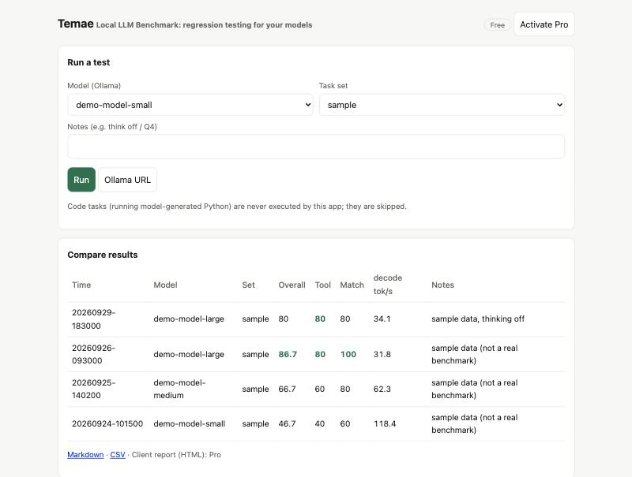
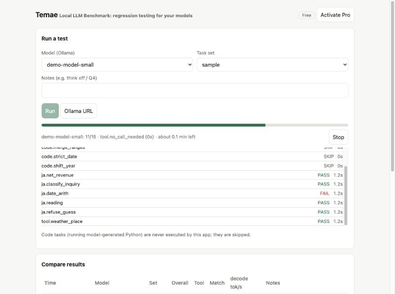
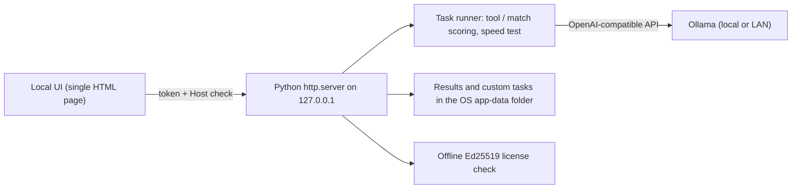

# Temae: Local LLM Benchmark

[English](README.md) | 日本語

> 公開しているのはドキュメントだけです。ソフトウェアはプロプライエタリで、ソースはこのリポジトリでは公開していません。*Temae は作業用の名称です。*

*点前（てまえ）は茶道の決まった手順のことです。同じ手順を、毎回同じやり方でこなす。このツールがモデルに対してやるのは、まさにそれです。*

**同じタスクスイートを、インストールしたすべてのローカルモデルに対して実行するデスクトップアプリ。新しいモデルが*あなたの*仕事にとって本当に良いものなのか確かめ、その根拠を示すレポートをクライアントに渡せます。**

*実行結果の比較。モデル名とスコアは合成的なサンプルデータで、実測のベンチマークではありません。*

## 課題
ローカル LLM は数週間ごとに変わります。公開のリーダーボードでは、自分のタスクに対して、自分のツール定義で、自分の言語で、自分のハードウェアと量子化設定でモデルがどう振る舞うかは分かりません。手でやり直すのは遅く、機密のタスクをクラウドサービスに送ることはできません。

## できること
- [Ollama](https://ollama.com) が提供するモデルならどんなものにもスイートを実行します（このマシンでも、ネットワーク上の別マシンでも）。
- **ツール呼び出し**（正しい関数、正しい引数、あるいは呼び出さないのが正しいケース）と**解答の一致**を採点し、生成速度（tokens/s）も測定します。
- 進行状況のライブ表示、タスク別の結果、重い推論モデル用の Stop ボタン。
- 実行結果を並べて比較。CSV と Markdown にエクスポート。有料ティアでは、クライアントに渡せる印刷対応の HTML レポートとタスクパックが追加されます。
- 自分のタスクはプレーンな JSON ファイルのまま、ディスク上に保存されます。タスクパック（マニフェストとバージョンを持つフォルダ）も追加できます。
- オフラインのライセンスキー：ライセンスサーバーなし、アカウントなし。

*実行中の画面：タスク別の PASS/FAIL、残り時間、Stop。応答はスクリプトで動かしたデモサーバーからのものです。*

## 機密の仕事のために
- 既定では、通信先はあなたが設定した Ollama の URL だけです。テレメトリもアナリティクスもありません。
- UI は `127.0.0.1` でのみリッスンし、すべての呼び出しに起動のたびに出るトークンが必要なので、ほかのマシンからもほかの Web サイトからも到達できません。
- モデルが生成したコードをアプリが**実行することはありません**。
- 予定されているオプション機能（まだ実装していません）では、公開ベンチマークのデータセットを、ソースとライセンスを確認したうえで Download ボタンを押したときだけダウンロードできます。

## 作り方

Python 標準ライブラリに `requests` と `cryptography` を加えて使います。PyInstaller でパッケージ化し、必要に応じて pywebview でネイティブウィンドウを表示します。

## 状態（正直な版）
| 確認済み | 方法 |
|---|---|
| 採点、API、ライセンス、タスクパック、中止、エクスポート、タスクファイルの検証 | 偽の Ollama に対する自動テスト 42 件（macOS） |
| デスクトップバイナリが起動して実在の Ollama モデルを一覧できる | macOS での PyInstaller ビルド |
| 実モデルでの採点 | 日本語の事務作業のドラフトラップ（30 タスク）を小さなローカルモデル 3 つで実行しました。結果は弱いモデルと強いモデルを分けられましたが、このパックは現在のモデルに対して簡単すぎるとも示しました |
| **未確認** | |
| Windows と Linux のビルド | CI は設定済み。まだ実際のマシンでは実行していません |
| ネイティブウィンドウのレイアウト | 起動は確認。レイアウトは点検していません |
| 公開ベンチマークの取り込み、複数マシンでの比較 | 計画中 |

## フィードバックを求めています
このページは、ローカルモデルを実行している人のためのものです。**分かりにくい点、抜けている点、誤っている点を教えてください**：[フィードバックフォーム](https://github.com/johnknash2025/temae-local-llm-benchmark/issues/new?template=feedback.yml)を使うか、[ディスカッション](https://github.com/johnknash2025/temae-local-llm-benchmark/discussions)を立ててください。特に知りたいこと：手でやり直しているモデル比較はどれですか？ スコアを信用する前に何が必要ですか？ どの言語、どのタスク種別を先に用意すべきですか？

機密データや個人データは投稿しないでください。

## 作成について
AI コーディングエージェントを使って最初から最後まで作成しました。書面化したルール（機密保持、隠れたテレメトリの禁止、正直な検証記録）と引き継ぎの手順にしたがって進めているので、1 つのエージェントが限界に達しても作業は続きます。

連絡先：準備中です。ソースコードは、案件についてご相談のうえ共有できます。

© johnkhappy. All rights reserved.
