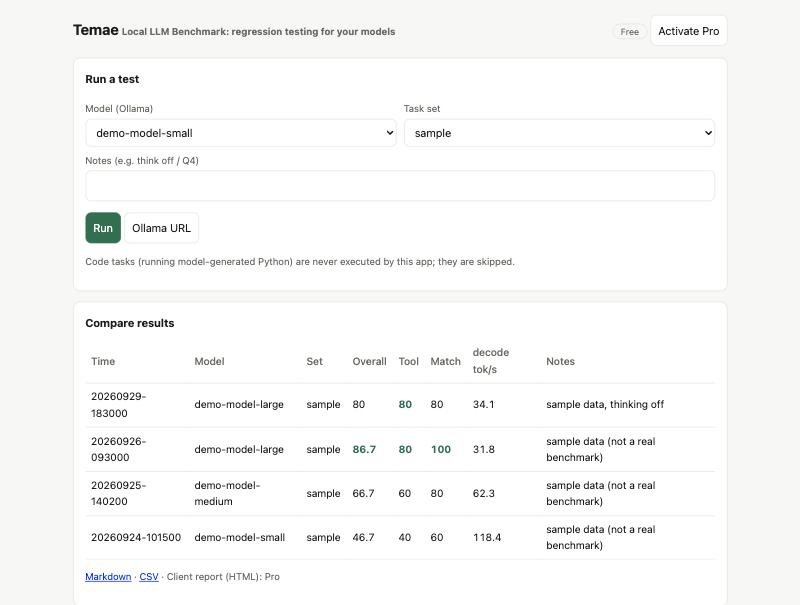
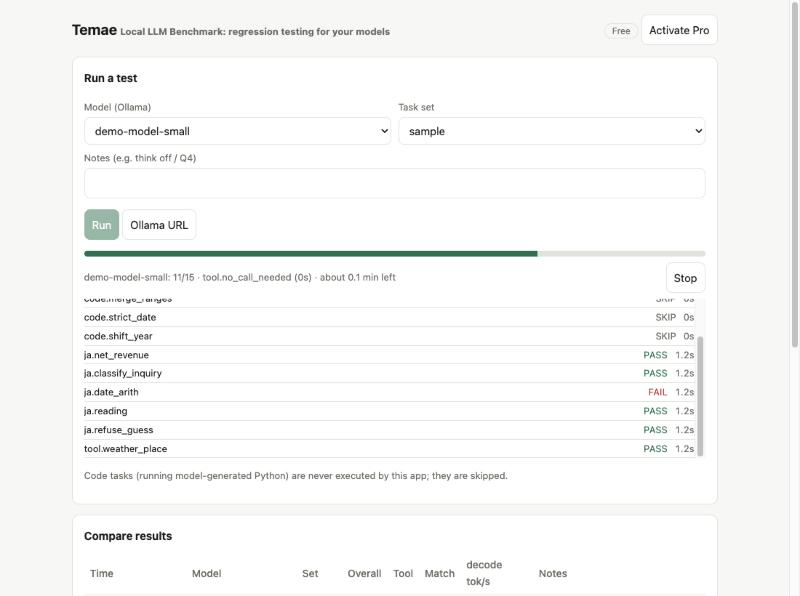
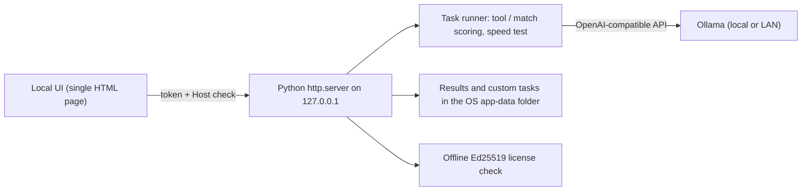

# Temae: Local LLM Benchmark

English | [日本語](README.ja.md)

> Documentation only. The software is proprietary and its source is not published here. *Temae is the working name.*

*Temae (点前) is the fixed procedure of the Japanese tea ceremony: the same steps, done the same way, every time. That is what this tool does for your models.*

**A desktop app that runs the same task suite against every local model you install, so you can see whether a new model is actually better for *your* work, and hand a client a report that shows it.**

*Comparing runs. Model names and scores are synthetic sample data, not a real benchmark.*

## The problem
Local LLMs change every few weeks. Public leaderboards do not tell you how a model behaves on your tasks, with your tool definitions, in your language, on your hardware and quantization. Re-checking by hand is slow, and confidential tasks cannot be sent to a cloud service.

## What it does
- Runs a suite against any model served by [Ollama](https://ollama.com) (this machine, or another one on your network).
- Scores **tool calling** (right function, right arguments, or correctly no call) and **answer matching**, and measures generation speed (tokens/s).
- Live progress, per-task results, and a Stop button for slow reasoning models.
- Compares runs side by side; exports CSV and Markdown. A paid tier adds a printable client-ready HTML report and task packs.
- Your own tasks are plain JSON files that stay on your disk. Task packs (folders with a manifest and a version) can be added.
- Offline license keys: no license server, no account.

*A run in progress: per-task PASS/FAIL, time left, and Stop. Responses come from a scripted demo server.*

## Built for confidential work
- By default the only network destination is the Ollama URL you configure. No telemetry, no analytics.
- The UI listens on `127.0.0.1` only and every call needs a per-launch token, so other machines and other websites cannot reach it.
- Model-generated code is **never executed** by the app.
- A planned, optional feature (not built yet) would let you download public benchmark datasets only when you press a Download button, after seeing the source and license.

## How it is built

Python standard library plus `requests` and `cryptography`; packaged with PyInstaller; optional native window via pywebview.

## Status (honest version)
| Verified | How |
|---|---|
| Scoring, API, licensing, task packs, cancel, export, task-file validation | 42 automated tests against a fake Ollama (macOS) |
| Desktop binary starts and lists real Ollama models | PyInstaller build on macOS |
| Scoring on real models | A 30-task Japanese office-work draft pack was run on three small local models; the results separated weak from strong models, and also showed the pack is too easy for current models |
| **Not verified** | |
| Windows and Linux builds | CI is configured, not yet run on real machines |
| Native window layout | launched, layout not inspected |
| Public-benchmark import, multi-machine comparison | planned |

## Feedback wanted
This page is for people who run local models. **Tell me what is unclear, missing or wrong**: use the [feedback form](https://github.com/johnknash2025/temae-local-llm-benchmark/issues/new?template=feedback.yml) or start a [discussion](https://github.com/johnknash2025/temae-local-llm-benchmark/discussions). Useful questions: Which model comparisons do you redo by hand? What would you need before trusting a score? Which languages or task types should come first?

Please do not post confidential or personal data.

## About
Built end to end with AI coding agents under written rules (confidentiality, no hidden telemetry, honest verification notes) and a handoff process, so the work continues when one agent hits a limit.

Contact: coming soon. Source code can be shared when we discuss a project.

© johnkhappy. All rights reserved.
